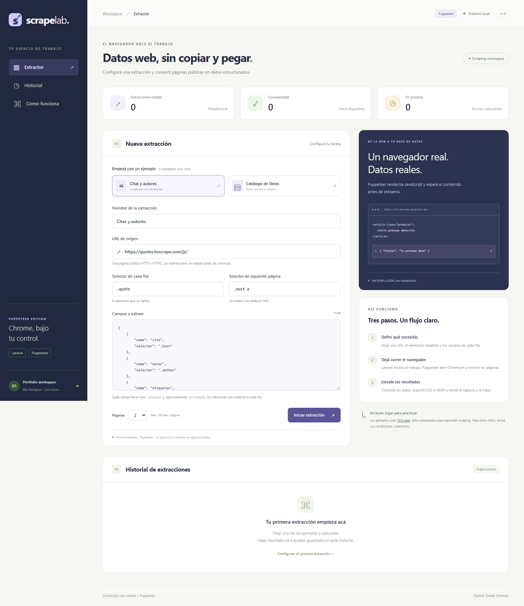
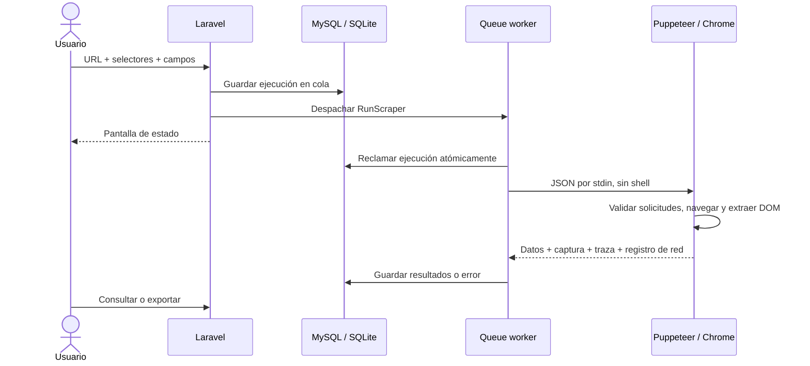
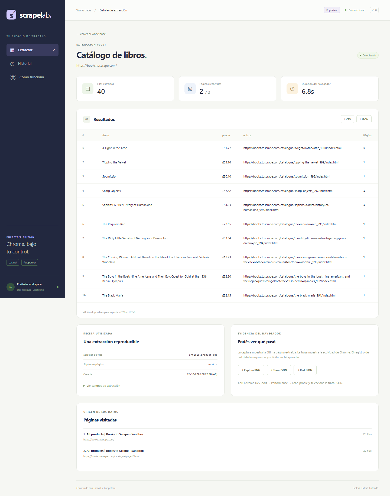

# ScrapeLab · Puppeteer Edition

Sistema de scraping con **Laravel 13, Puppeteer 25 y MySQL/SQLite**. Configurás una receta desde el navegador; Laravel encola el trabajo y un proceso Node controla Chrome para extraer datos, seguir páginas y guardar evidencias.

Proyecto de portfolio de **Blas Rodríguez**, creado como aplicación independiente de la versión con Playwright. Tanto el scraping como las pruebas E2E usan **Puppeteer**. No requiere Playwright.



## Funcionalidades

- URL pública y selectores CSS configurables.
- Ejemplos de citas con JavaScript y catálogo de libros con paginación.
- Extracción de texto y atributos (`href`, `src`, `title`, etc.).
- Hasta 10 campos, 5 páginas, 100 filas por página y 5.000 caracteres por valor.
- Estados en cola, en ejecución, completado y fallido; historial y actualización automática.
- Resultados en MySQL o SQLite y exportaciones CSV/JSON.
- Captura PNG, traza de Chrome JSON y registro de red JSON, también para diagnosticar fallos.
- Pruebas PHP, pruebas del motor con Chrome y pruebas E2E con Puppeteer + `node:test`.
- Workflow de GitHub Actions preparado para cuando publiques el proyecto.

Los ejemplos usan [ToScrape](https://toscrape.com/), un entorno de práctica. Los datos del historial se obtienen con ejecuciones reales.

## Instalación

Requisitos: **PHP 8.5**, Composer 2, **Node.js 22.12+**, npm y `pdo_mysql` o `pdo_sqlite`. Se necesita conexión a internet para descargar Chrome y visitar los sitios de ejemplo.

Desde el directorio del proyecto, en PowerShell:

```powershell
Copy-Item .env.example .env
composer install
php artisan key:generate
npm ci
npm run browsers
php artisan scraper:database
npm run dev
```

Abrí **http://127.0.0.1:8001**. `npm run dev` inicia el servidor Laravel y el worker de cola. El puerto 8001 permite usar esta aplicación junto a la versión de Playwright en el puerto 8000.

En Linux/macOS, usá `cp .env.example .env`. Si faltan bibliotecas del sistema para Chrome, seguí la [guía de troubleshooting de Puppeteer](https://pptr.dev/troubleshooting). El sandbox del navegador permanece habilitado.

Los scripts de instalación de npm están deshabilitados en `.npmrc`: **`npm run browsers` es necesario** para descargar el Chrome compatible con la versión instalada de Puppeteer. No se necesita Vite ni una compilación de frontend; los assets son locales.

### MySQL de WampServer

El `.env.example` compartido usa SQLite para facilitar que otra persona pruebe el repositorio. La instalación local de Wamp puede usar esta configuración:

```dotenv
APP_NAME="ScrapeLab Puppeteer"
APP_URL=http://127.0.0.1:8001
DB_CONNECTION=mysql
DB_HOST=127.0.0.1
DB_PORT=3306
DB_DATABASE=scrapelab_puppeteer
DB_USERNAME=root
DB_PASSWORD=
```

Reemplazá usuario, contraseña y puerto por los de tu instalación. `root` sin contraseña corresponde solamente a algunas configuraciones locales de Wamp.

```powershell
php artisan config:clear
php artisan scraper:database
```

El comando crea la base si no existe y ejecuta las migraciones sin borrar tablas. Las tablas MySQL usan InnoDB. Si el usuario no puede crear bases, creá `scrapelab_puppeteer` desde phpMyAdmin y luego ejecutá `php artisan migrate`.

Para servir con Apache, apuntá el virtual host a `public/` y habilitá `mod_rewrite`. El worker sigue siendo un proceso separado:

```powershell
php artisan queue:work --tries=1 --timeout=210
```

Si Apache no encuentra Node, configurá la ruta y reiniciá el worker:

```dotenv
SCRAPER_NODE_BINARY="C:/Program Files/nodejs/node.exe"
```

Cada instalación usa su propio `.env`, clave de aplicación, sesión, directorio de artefactos y base de datos.

## Configurar otro sitio

Definí la URL, el selector del elemento repetido, los campos relativos a cada elemento y, opcionalmente, un enlace de siguiente página con `href`.

```json
[
  { "name": "titulo", "selector": "h3 a", "attribute": "title" },
  { "name": "precio", "selector": ".price_color" },
  { "name": "enlace", "selector": "h3 a", "attribute": "href" }
]
```

Sin `attribute`, se usa `textContent`. Se normalizan espacios; los valores ausentes son `null`. `href` y `src` se convierten a URLs absolutas. `:scope` selecciona el propio elemento de la fila. Los nombres de campos son únicos y usan letras, números y guiones bajos, empezando con una letra.

Cada sitio necesita sus selectores. No existe una configuración universal que identifique automáticamente qué datos querés obtener. Los presets están en `config/scraper.php`.

## Arquitectura



| Archivo | Responsabilidad |
| --- | --- |
| `app/Services/PuppeteerScraper.php` | Contrato PHP → Node con Symfony Process |
| `app/Jobs/RunScraper.php` | Cola, estados, reclamo atómico y persistencia |
| `scripts/scrape.mjs` | Automatización del navegador con Puppeteer |
| `scripts/lib/network-policy.mjs` | Validación de URLs y direcciones DNS |
| `app/Http/Requests/StoreScrapeRunRequest.php` | Validación de la receta |
| `app/Http/Controllers/ScrapeRunController.php` | Historial, resultados y descargas |
| `tests/node/` | Pruebas del motor con un servidor controlado |
| `tests/e2e/` | Pruebas de interfaz con Puppeteer y Node Test Runner |

## Qué demuestra esta implementación

- `puppeteer.launch()` inicia Chrome headless con un contexto aislado por ejecución.
- `page.goto()` espera `domcontentloaded`; `page.waitForSelector()` espera el primer elemento visible. Esto también cubre contenido agregado por JavaScript después de la navegación.
- `page.$$eval()` extrae los campos en un recorrido del DOM. Los selectores se pasan como datos; no se ejecuta código proporcionado por el usuario.
- Los enlaces se resuelven respecto de la página actual. La paginación permanece en ese origen, evita ciclos y hace una pausa de 700 ms entre páginas.
- `page.createCDPSession()` habilita una única tubería `Fetch` que valida solicitudes, incluidos los saltos de redirección. En las respuestas de documentos se agrega una política CSP que restringe conexiones a HTTP(S) y bloquea workers, iframes y objetos. Las CSP existentes se conservan.
- `page.on('response')` y `page.on('requestfailed')` producen un registro acotado de hasta 2.000 eventos. El registro también incluye los bloqueos de la política de red.
- `page.screenshot()` guarda la última página; `page.tracing` guarda un timeline de Chrome con screenshots. No son las trazas ZIP ni los snapshots del DOM de Playwright.
- Laravel invoca Node con argumentos separados y JSON por stdin. El proceso tiene timeout de 190 s; el job, 210 s; `retry_after`, 240 s. Los errores quedan visibles y no se reintentan automáticamente.
- El reclamo condicional del job impide que una entrega duplicada vuelva a ejecutar un registro que ya dejó `queued`.
- Blade escapa el contenido y el CSV neutraliza fórmulas, manteniendo el valor original en el JSON.



### Comparación con el proyecto de Playwright

| Aspecto | Proyecto Playwright | Este proyecto Puppeteer |
| --- | --- | --- |
| Motor | Playwright Library | Puppeteer |
| Navegador utilizado | Chromium de Playwright | Chrome for Testing de Puppeteer |
| Espera de filas | Locator visible | `waitForSelector({ visible: true })` |
| Extracción del DOM | `locator.evaluateAll()` | `page.$$eval()` |
| Trazas | ZIP para Playwright Trace Viewer | JSON para Chrome DevTools Performance |
| Registro de red propio | No | `network.json` |
| Pruebas E2E | Playwright Test | Puppeteer + `node:test` |
| Redirecciones | Se pide la URL final | Se valida cada salto antes de continuar |
| Puerto / base local | 8000 / `scrapelab` | 8001 / `scrapelab_puppeteer` |

La comparación describe las implementaciones de estos dos repositorios, no límites generales de las bibliotecas.

## Revisar evidencias

Desde el detalle de una ejecución podés descargar:

- **Captura PNG:** viewport de la última página extraída.
- **Traza JSON:** abrí Chrome DevTools → Performance → Load profile y seleccioná el archivo.
- **Red JSON:** respuestas HTTP, fallos, bloqueos y tiempos relativos.

Los archivos están en `storage/app/private/scrapes/{id}/` y quedan excluidos de Git. No se incluyen cookies ni cuerpos de respuesta en `network.json`; las URLs y las capturas sí pueden contener datos del destino.

## Pruebas

```powershell
php artisan test --compact
npm test
npm run test:e2e
```

- **PHP:** validación, cola, idempotencia, estados, errores, escape HTML y exportaciones.
- **Motor:** un servidor local entrega contenido diferido mediante JavaScript/fetch. Chrome comprueba paginación, URLs relativas, campos ausentes, límite de filas, HTTP 404, redirecciones válidas, bloqueo de un destino privado y WebSockets, capturas y trazas reales.
- **E2E:** presets, JSON inválido conservado y diseño móvil. Inicia su propio Laravel y worker en el puerto 8011, con SQLite separada en `storage/framework/testing/e2e.sqlite`. Los procesos de prueba se cierran al terminar.

La prueba contra el sitio público de citas se activa de forma explícita:

```powershell
$env:SCRAPELAB_LIVE_TESTS="1"
npm run test:e2e
Remove-Item Env:SCRAPELAB_LIVE_TESTS
```

En Linux/macOS: `SCRAPELAB_LIVE_TESTS=1 npm run test:e2e`.

Así las pruebas habituales no dependen de la disponibilidad de un sitio externo. La suite E2E guarda screenshots de fallos en `test-results/`. El workflow de GitHub Actions está preparado, pero su ejecución remota depende de que publiques el repositorio.

## Alcance

Es una **demo local sin autenticación**, no un servicio público listo para alojar. Para publicarla necesitás autenticación, autorización por usuario, control de concurrencia, retención de artefactos y aislamiento de la red de salida del navegador. La validación de DNS no sustituye un firewall frente a DNS rebinding ni cubre por sí sola todos los canales de red de Chrome.

Se admiten páginas públicas HTTP(S), texto o atributos del DOM principal y paginación por enlaces. No se implementan login, CAPTCHA, evasión de bloqueos, scroll infinito, iframes ni botones de paginación sin `href`. El navegador aplica una CSP adicional; los sitios que requieren workers, iframes, WebSockets u objetos pueden no funcionar. Los documentos se procesan en memoria y se rechazan si superan 10 MB. Se omiten fuentes y medios para reducir trabajo.

Se rechazan credenciales en URLs, redes privadas/reservadas y puertos distintos de 80/443. La excepción de loopback está limitada al servidor de fixtures de las pruebas Node y no puede activarse desde el formulario. No se interpreta `robots.txt` automáticamente: usá sitios propios, de práctica o con permiso y respetá sus condiciones.

No subas `.env`, bases de datos, trazas ni credenciales al repositorio público. La instalación creó un Git local independiente; configurá el remoto del nuevo repositorio antes de hacer push.

## Recorrido para mostrar el proyecto

1. Ejecutá citas con JavaScript y explicá la espera por el selector.
2. Ejecutá libros con dos páginas y mostrá texto, atributos y URLs absolutas.
3. Exportá CSV/JSON y abrí la traza y el registro de red.
4. Usá un selector inexistente para explicar el timeout y el estado fallido.
5. Mostrá las pruebas y compará las APIs de los dos motores.

Referencias: [Puppeteer](https://pptr.dev/), [interacciones con páginas](https://pptr.dev/guides/page-interactions), [tracing](https://pptr.dev/api/puppeteer.tracing), [Chrome DevTools Protocol Fetch](https://chromedevtools.github.io/devtools-protocol/tot/Fetch/), [Laravel Queues](https://laravel.com/docs/13.x/queues).

## Licencia

MIT. Ver `LICENSE`.
